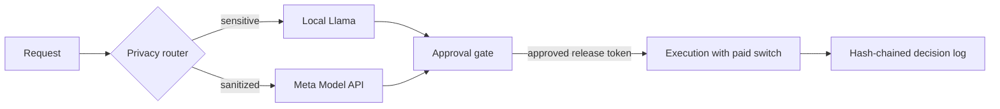

# ancientos-hackathon
AncientOS rebuild for the Meta hackathon (Oct 26–Nov 4, 2026).

A small Rust core that lets AI agents act on your behalf only through a fail-closed approval gate, a privacy router and a hash-chained decision log.

## Demo video

[Watch the demo](https://www.youtube.com/watch?v=lXqM33cO3EM)

## Meta stack

- **Meta Model API** (Muse Spark / Wonder) for hosted intelligence on sanitized text.
- **Llama running locally** (Ollama or llama.cpp) for sensitive data.
- **Muse Spark Open** (Meta open weights) on Baseten as an alternate image-analysis backend.

Muse Spark and Wonder are Meta's model names on the Meta Model API, not AncientOS crates.

## Why AncientOS exists

Built from scratch in Rust for this hackathon (Oct 26–Nov 4, 2026), distilling the governance and security core from a private ~180k-line Python assistant (not in this repo).

An AI agent is only useful if it can act: sync your bookmarks, run a coding job, ask a model a question. But most agents get that power by being handed your keys and trusted to behave.

AncientOS takes a different route: the agent can act, but it never holds unrestricted authority. Four jobs are kept apart:

```
 intelligence  ->  authorization  ->  execution  ->  evidence
 (models,          (gate + your       (runs once,     (hash-chained
  privacy router)   approval)          paid switch)    decision log)
```



- **Intelligence** proposes. A privacy router keeps sensitive or unclassified text on a local Llama model; only sanitized text goes to Meta's cloud models.
- **Authorization** decides. Actions an app hasn't registered are denied. Risky ones wait for your approval, on the CLI or your phone, and the approval is bound to a hash of the exact payload.
- **Execution** is limited. Anything that costs money stays off unless `ANCIENTOS_ALLOW_PAID=1` is set.
- **Evidence** is kept. Every decision lands in an append-only, hash-chained log, checked on every read.

Three apps (an X bookmarks curator, gated Muse Code runs, and Muse Wonder questions) share this one small core, which knows nothing about any of them.

What isn't done yet: the release-token type check covers paid execution but not every action; the log has no cross-process lock, and signing is opt-in (ANCIENTOS_LOG_KEY_PATH); code can still call a model client without going through the router. Those are next. The demo runs with an unsigned log; the live deploy can sign it.

## What this is
AncientOS hackathon build (Oct 26 - Nov 4 2026): a Rust core with a scheduler,
a fail-closed approval gate and an append-only, hash-chained decision log; a
privacy router (sensitive data -> local Llama via Ollama/llama.cpp,
sanitized -> Muse Spark / Wonder via the Meta Model API); and an X bookmarks
agent (read-only OAuth2 PKCE, incremental ingest that never infers removals).

## Layout
- `crates/core` - scheduler, approval gate, decision log
- `crates/router` - privacy router and model clients (Muse, local LLM)
- `crates/bookmarks-agent` - X bookmark ingest, fixture loader, CLI
- `crates/muse-runs` - second app: a Muse Code run is a gated action (propose, approve or deny, run once)
- `crates/web-ui` - loopback-only demo web UI (brief voting, ideas, try-it, log viewer)
- `fixtures/sample_bookmarks.jsonl` - 5 public sample bookmarks

## Run
```sh
cp .env.example .env   # fill in locally; never commit
scripts/ci_local.sh    # boundary, docs, strict Pyright, fmt, clippy, tests
cargo run -p bookmarks-agent --bin bookmarks-agent -- load fixtures/sample_bookmarks.jsonl
```

## Judge quick-start (about 2 minutes, no keys)

Everything below runs offline on synthetic fixtures. No `META_API_KEY`, X tokens,
or other credentials are needed. Leave `ANCIENTOS_ALLOW_PAID` unset: paid model
calls are off by default and fail closed before any network request.

Needs: a stable Rust toolchain (`rustup default stable`), bash, a browser.

```sh
git clone https://github.com/nathandavidgreene/ancientos-hackathon
cd ancientos-hackathon
unset ANCIENTOS_ALLOW_PAID
```

### 1. Offline demo (all 14 storyboard shots, ~10 s after first build)
```sh
scripts/demo.sh            # or: scripts/demo.sh --shot 6   (privacy routing)
```
Mock and local clients only, temp data dir, no network, no real data.

### 2. Web UI on demo data
```sh
cargo run -p web-ui -- --demo     # add --port 8799 if 8787 is taken
```
Open http://127.0.0.1:8787/ (loopback only, server-rendered, works without JS).
Use `--data DIR` instead of `--demo` to serve your own data dir.
The brief (`/`) and ideas (`/ideas`) pages work. `/m` (phone approvals) and
`/labels` report "off" without their tokens and private label queries; that is
expected. `/log` needs a scoped login.

### 3. Tests
```sh
cargo test --workspace --quiet    # 1041 tests on current main
```
Run from the repo root: `scripts/demo.sh` and its tests use `./target`, so do
not set `CARGO_TARGET_DIR`.

Sign-in security tests only:
```sh
cargo test -p web-ui --lib -- --test-threads=1 \
  valid_k_redirects_and_sets_exact_cookie invalid_k_is_forbidden_without_cookie \
  rendered_html_never_holds_token_or_k origin_and_host_must_match_an_explicit_allowed_origin \
  all_non_get_routes_require_authentication_and_session_csrf \
  socket_login_limiter_separates_forwarded_clients login_failures_are_throttled_per_peer_and_expire
```

### 4. Load the sample bookmarks
```sh
ANCIENTOS_HOME=$(mktemp -d) cargo run -p bookmarks-agent --bin bookmarks-agent -- \
  load fixtures/sample_bookmarks.jsonl      # prints: loaded 5 bookmarks
```

### Expected noise
`WARNING: ANCIENTOS_LOG_KEY_PATH is unset; decision log is UNSIGNED` appears
throughout. Keyless runs use an unsigned decision log; set that path to a key
file to sign it.

### What does not run without keys
- Live X bookmark sync (needs X OAuth client and tokens).
- Hosted Muse / Muse Code calls and `analyze-media` on real images (need
  `META_API_KEY` and `ANCIENTOS_ALLOW_PAID=1`).
- Phone approvals `/m` and `/labels` (need `ANCIENTOS_PHONE_TOKEN` and private
  label queries; the real deploy is on Nathan's own server).

## Post liveness
Before a post surfaces in the brief or web-ui, `bookmarks-agent` confirms it
still exists via the existing batched X lookup (`/tweets?ids=`, up to 100 per
request). Deleted posts, suspended/deleted authors and protected posts are
dropped silently — only a 24h on-disk cache entry (`liveness_cache.json`) is
recorded, never a decision-log entry. Transient errors fail closed (skipped,
not cached); `brief --offline` / `--demo`, `ANCIENTOS_OFFLINE=1` and paid-off
skip the check with no network. The agent itself is read-only on X. The one
exception is Delete on the labels page: each click un-bookmarks one post on X
through a separate X worker (not in this repo). Every attempt is logged, and
nothing is deleted on failure. Stored bookmarks are never deleted.
