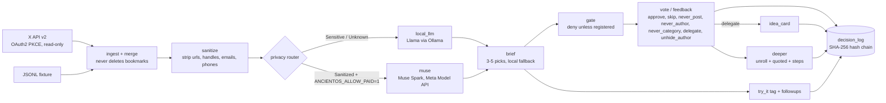
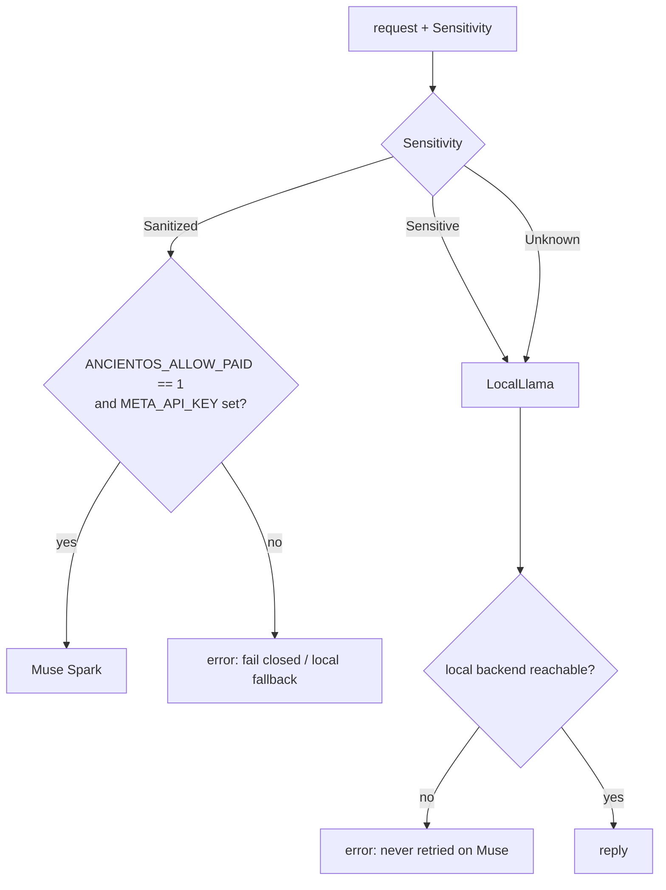
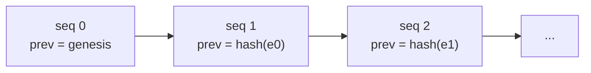

# AncientOS hackathon build: architecture

AncientOS turns your X bookmarks into a short daily brief. You approve or reject each pick, and those votes feed a tamper-evident decision log. A post can go further: to an idea card, a "Try it" follow-up, or a "go deeper" walkthrough. Private text never leaves the machine. Hosted Meta (Muse) models only ever see sanitized text, and only when the paid switch is on.

## Data flow

## Privacy router decision

## Decision log hash chain

Each entry stores `sha256(seq, prev, kind, payload)`. `verify()` recomputes the chain, and any edited, dropped or reordered line fails verification.

## Modules

| Module | Crate | Role |
|---|---|---|
| `gate` | core | Fail-closed approval gate. Unregistered actions are denied. |
| `log` | core | Append-only, hash-chained JSONL decision log |
| `feedback` | core | Verdicts and category auto-approval (at least 3 votes, at least 80% approve) |
| `scheduler` | core | Daily run timing |
| `router` (lib) | router | Sensitivity → destination routing |
| `dispatch` | router | Sends a routed request to the matching client |
| `local_llm` | router | Local Llama backend (OpenAI/Ollama compatible) |
| `muse` | router | Muse Spark client for the Meta Model API, behind the paid switch |
| `modal` | router | Hosted Llama stub (Modal), paid switch, fail closed |
| `oauth`, `callback`, `token_store` | bookmarks-agent | X sign-in (PKCE), loopback callback, tokens stored with mode 0600 |
| `x_api` | bookmarks-agent | Read-only X client: bookmarks, hydrate, threads, quotes |
| `ingest`, `merge`, `fixture` | bookmarks-agent | Incremental sync. Bookmarks are never removed. |
| `sanitize` | bookmarks-agent | Strips PII before anything is sent to a hosted model |
| `language` | bookmarks-agent | English detection: X `lang` wins, else offline script + stopword heuristic; undetermined counts as non-English (fail closed) |
| `translate` | bookmarks-agent | Non-English posts translated to English and surfaced, never skipped: Muse for sanitized text (paid switch), local LLM for sensitive, on-disk cache, fail open on visibility |
| `brief` | bookmarks-agent | Candidate selection, one model call, local fallback |
| `media` | bookmarks-agent | Photos and video under the full text, capped at 1080p |
| `vote` | bookmarks-agent | Records verdicts |
| `author_filter` | bookmarks-agent | Hides hidden-author posts in memory only (brief, web-ui, digest); no-author posts kept, store never modified |
| `unroll` | bookmarks-agent | Rebuilds an author's self-reply thread |
| `delegate`, `idea_card` | bookmarks-agent | Hand-off to the agent, and idea cards (adopt / park / drop) |
| `try_it` | bookmarks-agent | Hands-on classifier, tried yes/no/later follow-ups |
| `deeper` | bookmarks-agent | "Go deeper" walkthroughs |
| `try_it_cascade` | router | Try-it cascade: confident rules, else Jev `noul >= 0.5`, else Muse Spark; paid-gated, sanitized-only, fail-closed; scored by `crates/eval/src/bin/try_it_cascade.rs` |
| `jev_client` | router | Jev (TypeSafe / localjev) classifier client, off by default |
| `demo-runner` | demo-runner | Deterministic 12-shot demo on synthetic data |
| `eval` | eval (package `ancientos-eval`) | Offline precision/recall harness plus classifier-backend scoring ([eval.md](eval.md)) |

## Guarantees and the tests that prove them

| Guarantee | Test |
|---|---|
| Unknown actions are denied | [`gate::denies_unknown_action`](../crates/core/src/gate.rs) |
| A tampered decision log is detected | [`log::detects_tampering`](../crates/core/src/log.rs) |
| Sensitive data never reaches Muse | [`dispatch::sensitive_data_never_reaches_muse`](../crates/router/src/dispatch.rs) |
| Unknown sensitivity stays local | [`unknown_stays_local`](../crates/router/src/lib.rs) |
| Local Llama down means no fallback to Muse | [`local_llm::dispatch_sensitive_with_local_down_never_calls_muse`](../crates/router/src/local_llm.rs) |
| Local backend unreachable or malformed fails closed | [`unreachable_host_fails_closed`, `malformed_response_fails_closed`](../crates/router/src/local_llm.rs) |
| Paid calls are off by default | [`muse::paid_calls_disabled_by_default`](../crates/router/src/muse.rs), [`modal::paid_switch_defaults_off`](../crates/router/src/modal.rs) |
| A missing key fails before any network call | [`muse::missing_key_fails_closed_without_network`](../crates/router/src/muse.rs) |
| X paid endpoints need the switch | [`x_api::paid_switch_is_required`](../crates/bookmarks-agent/src/x_api.rs) |
| Only sanitized text goes into the brief prompt | [`brief::run_sends_only_sanitized_text`](../crates/bookmarks-agent/src/brief.rs) |
| Model failure falls back to local picks | [`brief::run_falls_back_when_model_fails`](../crates/bookmarks-agent/src/brief.rs) |
| PII is stripped | [`sanitize::combined_pii_is_removed`](../crates/bookmarks-agent/src/sanitize.rs) |
| Bookmarks are never deleted on a partial sync | [`ingest::partial_sync_never_removes`](../crates/bookmarks-agent/src/ingest.rs), [`merge::null_still_bookmarked_never_removes`](../crates/bookmarks-agent/src/merge.rs) |
| OAuth callback state mismatch fails closed | [`callback::state_mismatch_fails_closed`](../crates/bookmarks-agent/src/callback.rs) |
| Tokens are redacted in debug output | [`token_store::debug_redacts_token_values`](../crates/bookmarks-agent/src/token_store.rs) |
| never_post hides one post, not its category | [`feedback::never_post_is_excluded_from_stats_and_blocking`](../crates/core/src/feedback.rs) |
| Demo contains no private data | [`demo_runs_all_shots_deterministically_without_private_data`](../crates/demo-runner/tests/demo_script.rs) |
| Eval output contains no ids, urls or text | [`eval` tests](../crates/eval) |

## Jev (TypeSafe) backend

Opt-in backend in `crates/router/src/jev_client.rs`, selected with
discord-luna's env names. `JEV_BACKEND=auto` (default) reads
`LUNA_MODEL_MODE`: `frontier` selects the hosted TypeSafe API,
`local` selects a local Jev server. Explicit `JEV_BACKEND=typesafe` or
`localjev` overrides the mode. Any other value, or an unset mode under
`auto`, is an error (fail closed).

- **typesafe (frontier):** `TYPESAFE_BASE_URL` (default
  `https://api.typesafe.ai`), `TYPESAFE_API_KEY` (required, env only,
  never logged/stored), `TYPESAFE_DEFAULT_MODEL` (default
  `jev-preview`). Paid-gated by `ANCIENTOS_ALLOW_PAID=1`. Accepts
  sanitized/public content only; sensitive or unknown content is refused
  with an error, and `route_with_jev` never routes it to TypeSafe.
- **localjev:** `LOCALJEV_BASE_URL` (default
  `http://127.0.0.1:8080`), `LOCALJEV_DEFAULT_MODEL` (default
  `localjev-default`), optional `LOCALJEV_API_KEY` Bearer token. Not
  paid-gated. Data stays on the device, so any sensitivity is allowed.

Both backends share one request/response implementation
(`post_chat_completions`).

Jev is OFF by default and is only used where it beats the alternatives on
accuracy. Routing never picks `Destination::Jev` unless the calling task is
explicitly opted in via the per-task set `JevTasks` (`RouterConfig.jev_tasks`,
`route_for_task` / `dispatch_for_task`), read from `ANCIENTOS_JEV_TASKS` as a
comma list: `intent` enables `JevTask::IntentRouting`, `bookmarks` enables
`JevTask::BookmarkClassification`. Unset or empty means off; any unknown value
is an error (fail closed). When a task is opted in, sanitized content routes
to TypeSafe (`Destination::Jev`) while sensitive or unknown content routes
only to the local Jev server (`Destination::LocalJev`) — sensitive content
still never reaches TypeSafe.

The eval hook lives in `crates/eval` (package `ancientos-eval`): `evaluate`
scores any classifier backend (a `ClassifierBackend` trait object or an
`Fn(&str) -> Result<String, _>` closure) against labeled `(text, label)`
examples, returning accuracy, per-label precision/recall/F1, and macro F1,
with a `JevClassifier` adapter wrapping `jev_client`. Once live TypeSafe or
localjev access exists, compare Jev against the current backend on real labels
and opt a task in only if Jev wins. Caveats:

- The chat shape (OpenAI-compatible `POST /v1/chat/completions`, Bearer
  auth) is **UNVERIFIED** against the real TypeSafe API.
- No real localjev server has been verified yet; the backend is tested
  against a mock HTTP server only.
- No pricing or rate-limit info is known for either backend; demo only
  what the tests cover.

The offline try_it / brief-ranking harness from the docs-eval branch is the `harness` module of the same crate (`cargo run -p ancientos-eval`).
