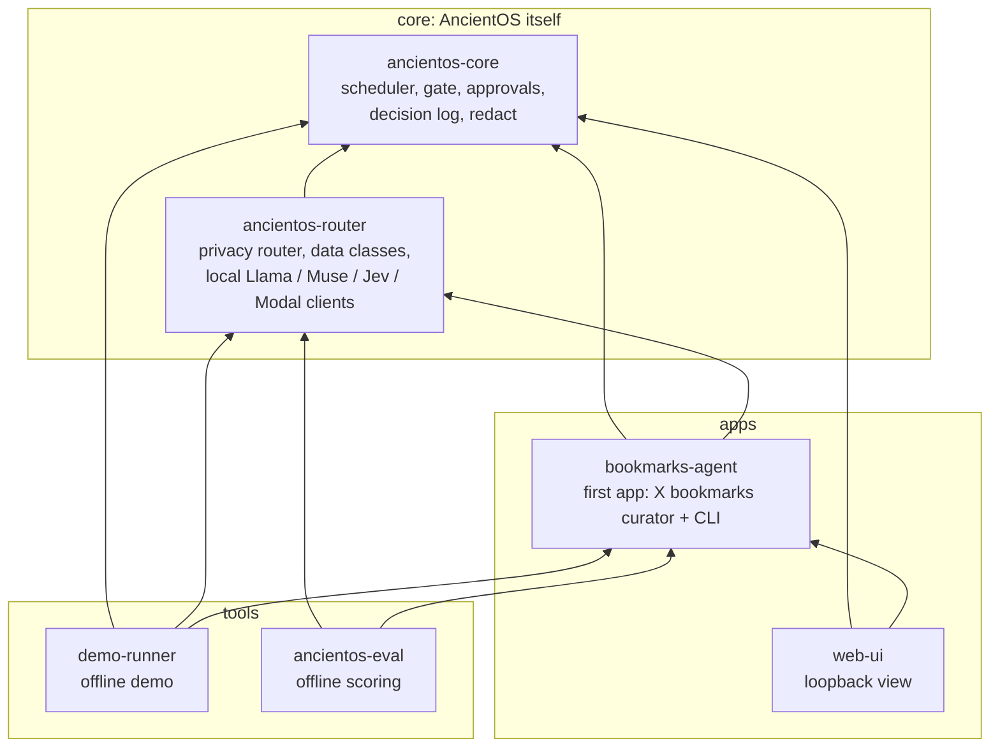
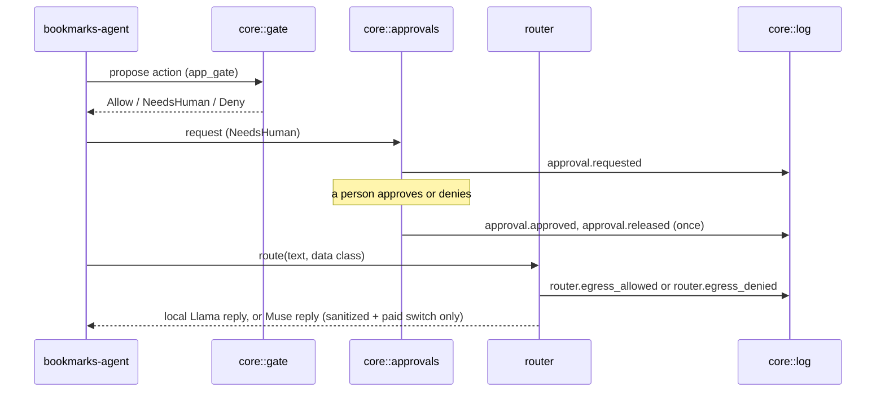

# Core and apps

Principle 7: core is distinct from applications. The test is "if this component
were removed, would AncientOS still be AncientOS?" If yes, it belongs in an app.

## Crate graph

Arrows point from a crate to what it depends on. Core depends on nothing in the
workspace; the router depends only on core; everything app-specific sits above.

## What stays in core, what moved out

| In core | Why it is core |
|---|---|
| `gate` | Generic, fail-closed: empty gate denies all, unknown actions deny. Apps register their own actions (`bookmarks_agent::app_gate`). |
| `approvals` | Human approval queue; the caller passes its gate. Bound to a payload hash, expires, releases once. |
| `log` | Append-only, hash-chained decision log every component writes to. |
| `redact` | Secret redaction before anything is logged or sent to a hosted model. |
| `scheduler` | Runs agents on a schedule. |
| `router::*` | Decides where data may go and talks to models; knows data classes, not bookmarks. |

Moved into `bookmarks-agent` (app specifics): `feedback`, `try_it_cascade`,
`topic_filter`, the bookmark category table, and the paid action constants.

## How the boundary is enforced

`scripts/check_core_boundary.sh` runs first in `scripts/ci_local.sh` and in demo
shot 14. It fails when:

- `ancientos-core` has any workspace dependency;
- `ancientos-router` depends on anything but `ancientos-core`;
- core or router source names app, transport or UI specifics (Discord, web UI,
  bookmarks-agent identifiers, bookmark categories, app action names).

## Runtime data flow across the boundary

