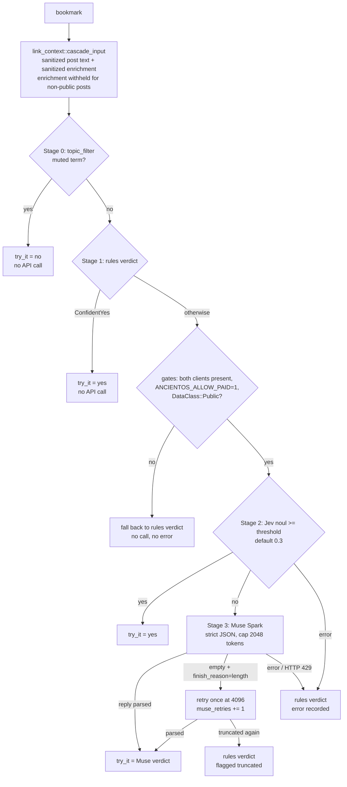
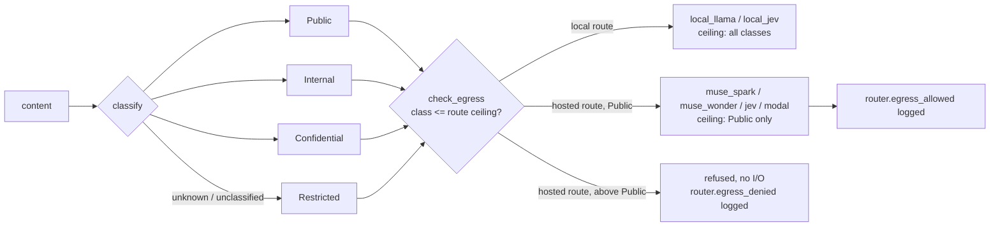
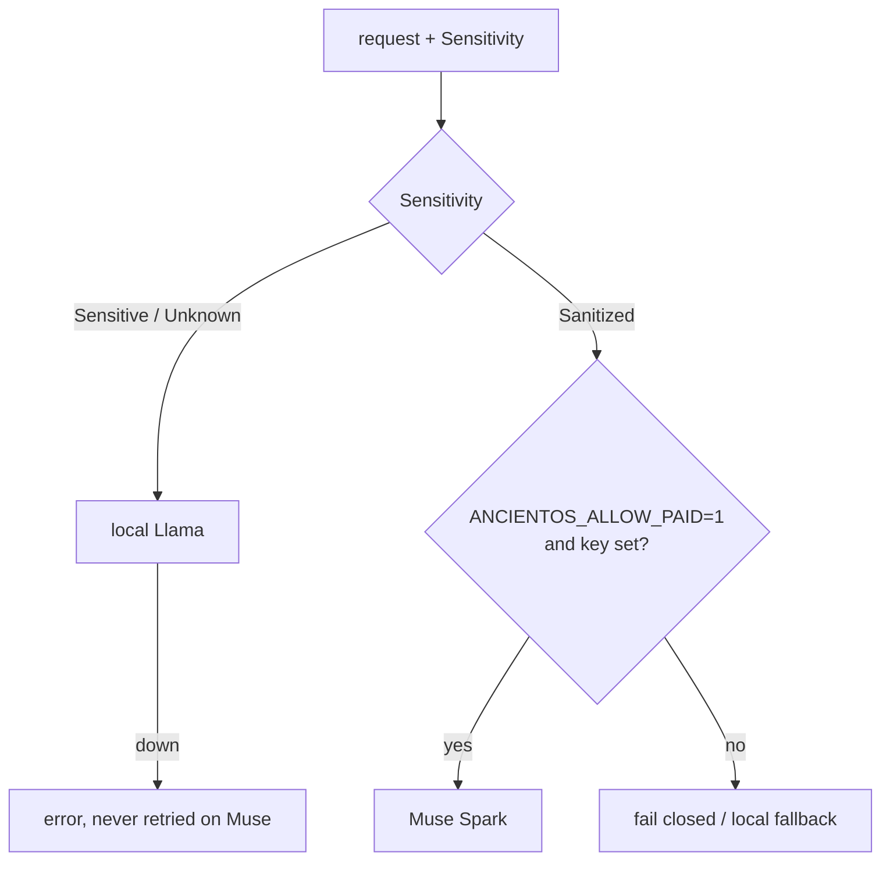
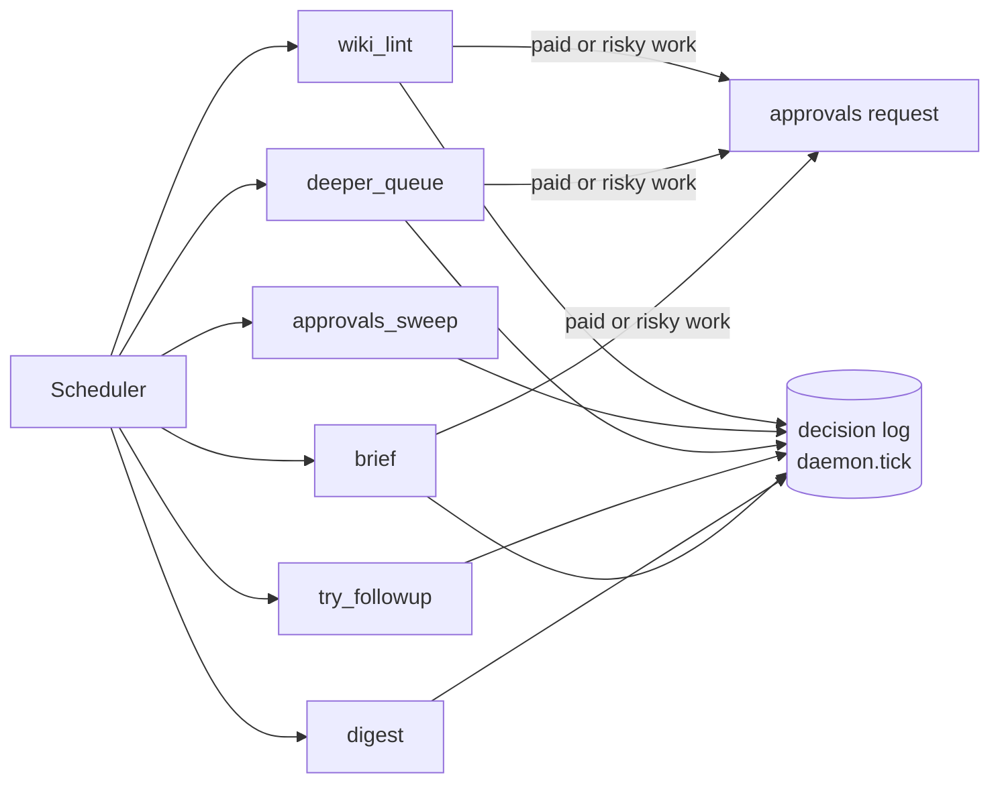
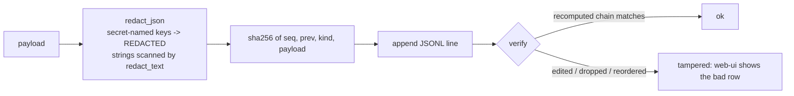
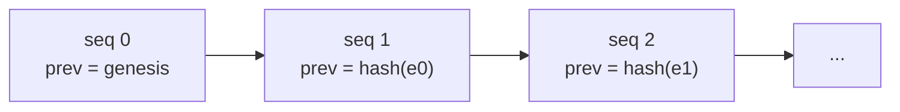
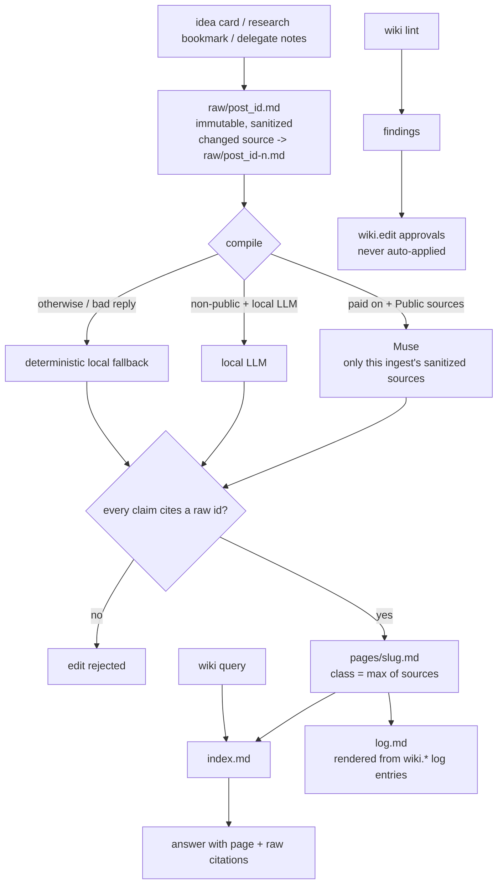

# Flows

Diagrams of the main runtime paths. Each is drawn from the module docs in the
source (see the [module reference](modules.md)).

## Try-it cascade

`bookmarks-agent::try_it_cascade`: cheap rules first, then Jev, then Muse Spark. Every
fallback lands on the rules verdict, and `Cascade::decide` never fails.



## Data class and egress

`router::data_class`: every piece of content has a class; every route has a
ceiling. A class above the ceiling is refused before any network I/O.



The older sensitivity router still sits in front: Sensitive or Unknown data goes
to the local Llama, and a local outage is never retried on Muse.



## Approvals and the daemon

`core::approvals` plus `bookmarks-agent::daemon`. State lives only in the
decision log; the daemon proposes paid work and only runs it after a human
approves the exact payload.

```mermaid
sequenceDiagram
  participant D as daemon (bookmarks-agent run)
  participant G as gate (default_gate)
  participant Q as approvals
  participant L as decision log
  participant H as human (CLI / web-ui)
  D->>G: evaluate brief.paid / deeper.paid / wiki.edit
  G-->>D: NeedsHuman (Risk::High)
  D->>Q: request(payload) - redacted, hashed
  Q->>L: approval.requested {id, payload_hash, expires_at}
  H->>Q: approve(id, payload_hash) or deny(id, reason)
  Q->>L: approval.approved / approval.denied
  D->>Q: claim_release_token + release(token, payload)
  Q->>Q: re-redact, re-check payload hash
  Q->>L: approval.released (exactly once)
  D->>D: run the paid action (still needs ANCIENTOS_ALLOW_PAID=1)
  Note over Q,L: undecided past expires_at reads as Expired;<br/>approvals_sweep records approval.expired.<br/>Denied or expired proposals never execute.
```

The daemon's six agents, each ticking on its own interval. One agent's error
never stops the others; every tick appends a `daemon.tick` entry.



## Decision log and redaction

`core::log` and `core::redact`. Every payload is redacted before it is hashed
and written; the chain makes any edit, drop or reorder detectable.





`redact_text` matches vendor keys (AWS, GitHub, Slack, `sk-` style, Google,
Stripe), JWTs, Bearer tokens, URL passwords, PEM private keys and credential
assignments, and replaces each with `[redacted:<kind>]`. Obvious placeholders
pass through. The same redaction runs inside `sanitize`, so every hosted-call
input is redacted.

## Wiki

`bookmarks-agent::wiki`: idea cards and research bookmarks distilled into cited
concept pages.


